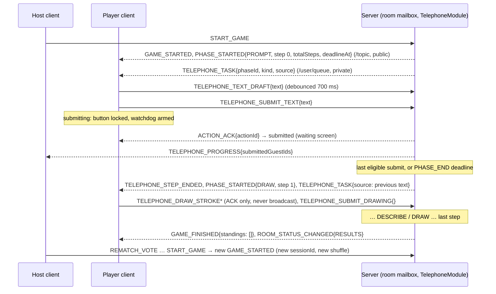

# DinoParty — Dino Telephone Design (Phase 6)

Status: **P6-01 design; P6-02 (the step phases `PROMPT`/`DRAW`/`DESCRIBE`) is implemented in `games.telephone`, the step gameplay UI in `frontend/src/features/telephone`, and the multiplayer integration of both is verified end to end (P6-04, §15); the reveal, album persistence and album endpoints (P6-03) are not.** The `entriesPerChain` default shipped as migration `V9__telephone_settings.sql`, so `game_submission` (§12.2) becomes `V10`. Decisions D35–D48 are **PROPOSED** and listed in §14 (mirrored in `docs/decisions-and-risks.md` §7); the rules (`game-rules.md` Game 2) and the contract (`api-contracts.md` §3.10) already apply the recommended option, marked *(proposed, Dn)*. If one is rejected, rules and contract change in a `docs(contract)` commit before the task that depends on it (§13) starts.

Written against the Phase 4 engine and the Phase 5 drawing library as merged (`docs/game-engine.md`, `docs/draw-guess-design.md`; code read: `engine.GameModule`, `Transition`, `GameDefinition`, `GameRegistry`, `drawing.CanvasBuffer`/`CanvasLimits`, `room.SettingsSchema`, `realtime.CommandRouter`, migrations `V2`–`V8`). Normative sources: rules `game-rules.md` `[TP-*]`, wire formats `api-contracts.md` §2.1/§3.10. Where this document and those differ, they win; fix this document. **No separate engine, no new messaging infrastructure and no new transport**: Telephone is a `GameModule` (`telephone`) behind the same registry, mailbox, STOMP streams, snapshots and recorder as Draw & Guess. One small SPI addition is proposed (§12.1, R21).

## 1. Scope and contradictions found

The earlier text (rules, contract, engine doc) disagrees with itself or with the code in the places below. None is resolved silently: each row names the conflict, what the new text applies, and the decision that owns it.

| ID | Conflict | Applied (proposed) | Decision |
|---|---|---|---|
| TC1 | Contract §3.3 / rules: `TELEPHONE_SUBMIT_DRAWING{strokes}` one-shot up to 256 KB, 600 strokes, 20 000 points. But the STOMP frame cap is 64 KiB (D20, open), a snapshot is bounded at 256 KiB (engine §7.1), and D28 set the shared `Stroke` budget at 300 strokes / 12 000 points because of that bound. | Reuse the Draw & Guess batch protocol into a **private server-held draft** (`CanvasBuffer`, same limits as `[DG-14]`); `TELEPHONE_SUBMIT_DRAWING` carries no strokes and commits the draft. 600/20 000/256 KB are dropped; D20 (raise the frame cap) is **not needed** and the cap stays 64 KiB. | D36 |
| TC2 | `GameRegistry` refuses a command type declared by two games, so Telephone cannot reuse `DRAW_STROKE`/`DRAW_UNDO`/`DRAW_CLEAR` (declared by `draw-guess`). Contract §3.6 asks game prefixes for new games. | New types `TELEPHONE_DRAW_STROKE`, `TELEPHONE_DRAW_UNDO`, `TELEPHONE_DRAW_CLEAR` with payloads identical to §3.9. | D36 |
| TC3 | `[TP-5]`: a missing drawing becomes an *empty* canvas; with a server-held draft a player who drew until the deadline would lose all of it. `[TP-5]` also says placeholders are passed on, and `allowSkipTimeout` has no defined meaning when `false`. | Deadline auto-submits the draft as it stands (text or strokes); only an empty draft becomes the placeholder. `allowSkipTimeout` stays accepted but only `true` is supported. | D37, D39 |
| TC4 | `[TP-7]` answers a second submission with `DUPLICATE_ACTION`, but that code means "same `actionId` seen" (§3.3). | New code `ALREADY_SUBMITTED`. | D36 |
| TC5 | Snapshot `TelephoneSnapshot.phase` lists `WAITING`, but the engine has exactly one current phase per session (`phaseId`); a per-player "waiting" cannot be a phase. | `WAITING` is not a phase: the viewer's `submitted:true` is the waiting screen. Phase names are `PROMPT`, `DRAW`, `DESCRIBE`, `REVEAL`. | D35 |
| TC6 | `[TP-4]` waiting screen shows "names only" but `TELEPHONE_PROGRESS` has only counts. | `TELEPHONE_PROGRESS` also carries `submittedGuestIds` (no content). | — |
| TC7 | `[TP-6]`/`ALBUM_REVEALED` put reveal entries (possibly ~200 KB of strokes) on the public stream, while a reconnect snapshot must stay < 256 KiB. `GET /sessions/{id}/albums/{chainIndex}` says "after reveal" without saying whether during or after the REVEAL phase. | Reveal entries travel in `ALBUM_REVEALED`; the snapshot carries the cursor, the revealed texts and drawings within a byte budget (the rest `omitted`); the REST album endpoints answer only once the session is `FINISHED`. | D43, D45 |
| TC8 | Rules: "if active players < 3, the game ends early **and reveals what exists**". The engine ends the session through `[C-1]` and the module cannot start a `REVEAL` after that. | No reveal phase after an early end; the albums of what exists are available through REST from `RESULTS`. During a running `REVEAL` the same rule ends the reveal. | D41 |
| TC9 | Rules: `entriesPerChain` "even or `n`" vs decision A12 "any value 4 ≤ E ≤ n"; the key is missing from contract §2.2, `SettingsSchema` and the `V2` defaults. | `entriesPerChain` 0 (auto) or 4–8, any integer, clamped to `n` when the roster freezes; odd values get a lobby hint. | D38 |
| TC10 | Engine doc §8.2: submissions go through the droppable recorder queue, but a dropped submission is a hole in an album, i.e. in the product. `game_submission` was deferred to Phase 6 and `GameOutcome`/`Transition` have no way to carry one. | `SubmissionRecord` on `Transition`, written never-drop (retry until success, like results); table in `V9`. | D44 |
| TC11 | `[TP-6]` says a host steps through albums, "15 s auto-advance if host absent", with no deadline, so a connected but idle host could hold the room in `REVEAL` forever (every other phase has a deadline). | Host-driven, plus an idle auto-advance (60 s; 15 s while the host is disconnected). | D42 |
| TC12 | `[C-1]`/D23 give Telephone `minActivePlayers = 3` while `minPlayers = 4`. Consistent (a start needs 4 connected; the game survives down to 3 active), stated here so nobody "fixes" it. | Unchanged. | — |

Out of scope here (post-MVP, unchanged): album export/sharing, reactions, a "strict" mode for timeouts, spectators, text-prompt packs.

## 2. Roles and what each viewer may see

| Role | Who | Can | Never sees |
|---|---|---|---|
| **Holder** | every roster member not `LEFT`, in every step: each holds exactly one chain per step `[TP-1]` | submit text / draw / commit for the held chain; own draft | any entry except the immediately preceding one; who wrote it (not sent); other players' tasks, drafts or submissions; the chain they held before |
| **Host** | independent of the above (engine `[C-2]`) | `REVEAL_NEXT`/`REVEAL_PREV` in `REVEAL`; engine-level close/kick/rematch | extra power in steps |
| **Outsider / non-member** | — | nothing (cannot subscribe) | everything |

Roles are never read from client data. Every holder of a step has one task, so Telephone has no `NOT_DRAWER`-style role error: authorization is "on the roster and not `LEFT`" (engine) plus the legal-phase table of `CommandSpec`.

## 3. Player counts

- `minPlayers 4`, `maxPlayers 8` (default max 8); `minActivePlayers 3` `[C-1]`; `scored = false`. Even and odd `n` are supported. The roster `n` is the frozen engine roster at the end of the 3 s countdown (`[C-4]`: every current member, including one in grace), not the number connected when the host pressed start.
- Rationale: below 4 a chain returns after 3 hops and a 3-player album has two drawings at most; above 8 a full game (§6) runs ≈ 9 minutes at defaults plus reveal; both ends stay inside the approved range (A9, A12, D6).
- The allocator is also proved for `n = 3…12` (property test) so a later range change needs no new maths.

## 4. State machine

### 4.1 Relationship to the shared lifecycle

All steps and the reveal live inside the room status `PLAYING`; `GAME_STARTED` precedes the first `PHASE_STARTED`; `GAME_FINISHED` and `ROOM_STATUS_CHANGED{RESULTS}` follow the last reveal (api-contracts §3.7).

### 4.2 Phases

`PROMPT` (step 0) → `DRAW` / `DESCRIBE` alternating (steps 1 … E−1) → `REVEAL` → finish. Step `k` odd = `DRAW`, `k` even > 0 = `DESCRIBE`. Each step phase gets a **fresh `phaseId`**; `REVEAL` is one phase for all albums (cursor-guarded commands, §9).

```
init ─► PROMPT ─► (DRAW | DESCRIBE)[1] ─► … ─► (DRAW | DESCRIBE)[E−1] ─► REVEAL ─(REVEAL_NEXT past last entry)─► finish ─► engine: GAME_FINISHED ─► RESULTS
           each step: ends when every eligible holder submitted, or on its deadline
           any phase: active players < 3 ─► engine [C-1]: finish with results (≥ 1 completed step) or abort
```

| # | From → To | Trigger (inside the mailbox) | Guards | Events (in order) | Deadlines |
|---|---|---|---|---|---|
| T1 | init → `PROMPT` | session start | `n`, `E` fixed (§5.2); chains allocated (§5.1) | `PHASE_STARTED{PROMPT, step 0, totalSteps E}`, private `TELEPHONE_TASK` to each non-`LEFT` holder | `PHASE_END` +`promptSeconds` |
| T2 | step `k` → step `k+1` | last eligible holder submits, **or** `PHASE_END` fires, **or** an unsubmitted holder becomes `LEFT` and the eligible set is then all-submitted | `k+1 < E`; unsubmitted holders are filled first (§7.3) | closing: `TELEPHONE_STEP_ENDED`; `PHASE_STARTED{DRAW\|DESCRIBE, step k+1}`; private `TELEPHONE_TASK` per holder | `PHASE_END` +`drawSeconds`/`describeSeconds` |
| T3 | step `E−1` → `REVEAL` | as T2 | — | closing `TELEPHONE_STEP_ENDED`; `PHASE_STARTED{REVEAL}`; `ALBUM_REVEALED{0,0}` | `deadlineAt: null`; INTERNAL `reveal-auto` (§9) |
| T4 | `REVEAL` stays | `REVEAL_NEXT` / `REVEAL_PREV` from the host, or `reveal-auto` | host, cursor guard (§9) | `ALBUM_REVEALED` | replaces `reveal-auto` |
| T5 | `REVEAL` → finish | `REVEAL_NEXT` on the last entry of the last album, or `reveal-auto` there | host or auto | `Transition.finish()` | engine |
| T6 | any → engine finish/abort | non-`LEFT` players `< 3` | engine `[C-1]` | the engine's; the step in progress is discarded (its accepted submissions are kept, §11) | — |

Draft commands inside a step are not transitions (state changes only, no events). Invariants (property-tested): exactly one current phase; every non-`LEFT` roster member holds exactly one chain per step; no holder sees an entry other than the immediately preceding one of the chain they hold; a chain has exactly `step` entries before step `step` and exactly `E` after the last step; `submitted ⊆ roster`; drafts exist only for holders of the current step; ledger is empty.

## 5. Chain allocation `[TP-1]`, entries per chain `[TP-2]`

### 5.1 Allocation (deterministic)

`order = [p0 … p(n−1)]` is the engine's shuffle (the only randomness; made once at start, `[C-4]`). Chain `c_i` is owned by `p_i`; entry `k` of `c_i` is held and written by `p_((i + k) mod n)`; equivalently player `p_j` holds chain `c_((j − k) mod n)` at step `k`. For `E ≤ n`:

1. each step is a permutation (one chain per player, one holder per chain);
2. a player holds a chain at most once, and the chain they own only at step 0 — so **nobody ever receives, or sees, a chain they have already contributed to**, including the chain that started with their own prompt: the previous entry is always written by someone else (`p_(j−1)`), and the holder never touched the chain before;
3. a holder sees only entry `k−1` (private task, §8);
4. every chain ends with exactly `E` entries.

"Where feasible": it is feasible for every `n ≥ 2`, `E ≤ n`, with no search. The cost, accepted in D47: each player always receives work from the same predecessor `p_(j−1)` (the drawing they describe is always their neighbour's). The Latin-square alternative (varying offsets) hides that but changes `[TP-1]`'s tested formula; not recommended for the MVP.

A `LEFT` player keeps their index (engine roster slots are stable): the allocation never recomputes, so a departure cannot make anyone receive a repeated or own chain; their cells are auto-filled (§7.3).

### 5.2 Entries per chain

`E` is fixed at `init` from the frozen roster size and the setting `entriesPerChain`: `0` (auto, default) → `n` if `n` even else `n − 1`; `4…8` → `min(setting, n)`. `E ≥ 4` always holds because `n ≥ 4`; for `n = 5` auto gives 4. Odd `E` makes the last entry a description (the album ends with text); the lobby shows the hint "Albums will end with a description." for an odd explicit `E` or when the current player count makes the auto value odd-capped. The effective `E` is public (`PHASE_STARTED.totalSteps`, snapshot `entriesPerChain`); `GAME_STARTED.settings` echoes the stored setting. (D38.)

### 5.3 Timeline example (`n = 4`, `E = 4`)

| step | `c0` | `c1` | `c2` | `c3` | phase |
|---|---|---|---|---|---|
| 0 | p0 | p1 | p2 | p3 | PROMPT |
| 1 | p1 | p2 | p3 | p0 | DRAW |
| 2 | p2 | p3 | p0 | p1 | DESCRIBE |
| 3 | p3 | p0 | p1 | p2 | DRAW |

## 6. Timers and submission deadlines

| Phase | Duration (default) | Advertised `deadlineAt` | Ends early when |
|---|---|---|---|
| `PROMPT` | `promptSeconds` (60; 20–120) | start + duration | every eligible holder submitted |
| `DRAW` | `drawSeconds` (90; 30–180) | start + duration | same |
| `DESCRIBE` | `describeSeconds` (45; 20–90) | start + duration | same |
| `REVEAL` | none (constants: idle auto-advance 60 s, 15 s while the host is disconnected) | `null`; `reveal.autoAdvanceAt` in the snapshot/events | the last entry of the last album is passed |

- Deadline rules are the engine's: a due deadline is applied before any command `[C-6]`; a command processed at/after its phase's deadline is `STALE_ACTION`. **Telephone adds no grace**, and needs none: drafts are held by the server (§8), so a player's text/strokes up to the last accepted draft message are never lost to a late final click (D37).
- A new step starts in the same mailbox command that ended the previous one; the new `deadlineAt` is measured from that instant, so time saved by an early finish is not carried over.
- Worst case at defaults, `n = 8`, `E = 8`: `60 + 4 × 90 + 3 × 45 = 555 s` (≈ 9 min) before reveal; typical games end steps early.
- Eligibility for early end: roster members not `LEFT`. A `DISCONNECTED` holder stays eligible and blocks early end during the 60 s in-game grace (consistent with D25/D23; a network blip must not cost a player their turn); when the grace expires they become `LEFT`, are filled (§7.3) and the step is re-evaluated at once. Because the step also has its own deadline, the worst delay is `min(grace, remaining time)`. (D48.)

## 7. Submissions, early submit, timeout, leaving

### 7.1 Accepted input

| Phase | Commands | Rules |
|---|---|---|
| `PROMPT`, `DESCRIBE` | `TELEPHONE_SUBMIT_TEXT{text}`, `TELEPHONE_TEXT_DRAFT{text}` | sanitize (strip `Cc`/`Cf`, trim), 1–140 Unicode code points; the draft may be empty (clears it) |
| `DRAW` | `TELEPHONE_DRAW_STROKE`, `TELEPHONE_DRAW_UNDO`, `TELEPHONE_DRAW_CLEAR`, `TELEPHONE_SUBMIT_DRAWING{}` | stroke protocol and budgets of `[DG-14]` applied to the holder's own draft; submit accepts an empty canvas (a deliberate blank page) |
| `REVEAL` | `REVEAL_NEXT`, `REVEAL_PREV` | host only |

### 7.2 Early submit and finality `[TP-7]`

A valid `TELEPHONE_SUBMIT_*` is **final** (MVP). The holder moves to the waiting screen (`submitted:true`); any later input from them in this step — a second submit or further draft/draw commands — is `ALREADY_SUBMITTED` (`retryable:false`), state unchanged. Progress is public (`TELEPHONE_PROGRESS`, names and counts only). When the last eligible holder submits, the step ends in that same command (reason `ALL_SUBMITTED`). Re-opening a submission is post-MVP.

### 7.3 Timeout, auto-fill, leaving `[TP-5]`, `[TP-10]`

Every cell `(chain, step)` ends with exactly one entry. When a step closes, each eligible holder without a submission is filled:

| Situation | Entry |
|---|---|
| Deadline, holder has a non-empty draft | the draft as it stands, `fill: TIMEOUT`, `timedOut: true` (a partial drawing is kept) |
| Deadline, empty draft, `DESCRIBE` | text `(no description)`, `fill: TIMEOUT`, `placeholder: true` |
| Deadline, empty draft, `DRAW` | empty canvas, `fill: TIMEOUT`, `placeholder: true` |
| Deadline in `PROMPT`, no draft | a prompt from the pool (§7.4), `fill: AUTO_PROMPT` |
| Holder is `LEFT` at step start | filled immediately at step start: a left holder's cell never waits; `fill: LEFT_PLAYER` (prompt: `AUTO_PROMPT`); no draft exists |
| Holder becomes `LEFT` during the step, unsubmitted | filled at once from their draft if non-empty, else as a placeholder, `fill: LEFT_PLAYER`; then the step is re-evaluated for early end |
| Holder becomes `LEFT` after submitting | nothing; their entry stands |

A placeholder is passed on as the next holder's source (`source.placeholder: true`, so the UI can say "nothing to go on — go wild") and shown in the album with a badge (D40: the existing `[TP-5]` behaviour; the alternative, replacing it with a fresh prompt, is not recommended because it breaks the chain's meaning silently). `DISCONNECTED` within the grace changes nothing; the draft is on the server, so a returning player continues where they were.

### 7.4 Auto prompt pool `[TP-3]`

Auto prompts come from the **built-in word catalog** (WP-01: original, blocklisted, `en`), difficulty `EASY` ∪ `MEDIUM`, resolved and frozen in `prepare` like the Draw & Guess pool (so a catalog change never reaches a running game) and drawn without replacement per session with the seeded `ctx.random()` (the prompt becomes public at reveal anyway; there is no unchosen-word secrecy to protect). No new content, no custom packs (D46). A pool smaller than needed falls back to repeats; the catalog has 537 such words.

## 8. Private assignments, drafts, drawing storage

### 8.1 What each audience receives

| Datum | Holder (own) | Other players | Public stream | Persisted |
|---|---|---|---|---|
| Task (`kind`, source = previous entry) | private `TELEPHONE_TASK`, own snapshot | never | never | the entry itself when accepted |
| Source author | **not sent** | never | never | `game_submission` |
| Own draft (text or strokes) | own snapshot only; drawing batches are **not echoed** to anyone | never | never | no (only the committed/auto-submitted entry) |
| Entries of earlier steps of the held chain | never | never | never | yes |
| Submitted-ness of players | `TELEPHONE_PROGRESS`, snapshot | same | yes (names only) | no |
| Any entry content | — | — | **only** via `ALBUM_REVEALED` in `REVEAL` | yes |

`TELEPHONE_TASK` is one private event per holder at step start, published after the public `PHASE_STARTED` (engine rule: a client never holds a secret without the phase it belongs to). Private events go to the principal-derived recipient only; no event, error message or log line contains entry text or points (hardening H1 analogue; the secrecy harness of task 4.4 runs on Telephone with holder/other-member/outsider recorders, asserting that a given entry appears only in the one task event of its next holder until `ALBUM_REVEALED`).

### 8.2 Drawing: reuse of the Draw & Guess canvas protocol (D36)

- Same wire format as §3.9: batches `{strokeId, batchNo, tool, color, size, points:[[x,y]], final}`, integer coordinates 0–10 000, batch ≤ 200 points / 8 KiB, ≤ 2 000 points per stroke, ≤ 300 strokes, ≤ 12 000 live points, undo/clear refund budget, whole-batch `PAYLOAD_TOO_LARGE` on exhaustion, `batchNo` ordering, implicit close by a new `strokeId`. The server code is `drawing.CanvasBuffer` unchanged (one buffer per holder per `DRAW` step); the client canvas engine is the Phase 5 one with a command-type mapping (`DRAW_*` ↔ `TELEPHONE_DRAW_*`).
- **No broadcast.** Draw & Guess publishes `DRAWING_UPDATED` because others watch. Telephone must not: an accepted batch is only acknowledged (`ACTION_ACK`). That is also why D17's "owner ignores its echo" does not arise.
- Rate limits per type equal §3.9 (`TELEPHONE_DRAW_STROKE` 30/s burst 40, 8 KiB; undo 5/s b5; clear 2/s b3). No frame-cap change: the largest inbound frame is the 8 KiB batch, far below 64 KiB. `TELEPHONE_SUBMIT_DRAWING{}` is ≤ 128 B.
- **Commit** (`TELEPHONE_SUBMIT_DRAWING` or timeout) freezes the buffer into an immutable `DrawingEntry(strokes)`; the draft is dropped. The snapshot-free memory bound per room is `n` live drafts (≈ 1 MB each, H6) plus all accepted entries (≤ `n × ⌊E/2⌋` drawings, ≈ 200 KB worst case each ⇒ ≈ 6.5 MB worst case, typically two orders of magnitude less).
- **Text drafts** (`TELEPHONE_TEXT_DRAFT`, ≤ 2/s) let the deadline keep half-typed text and let a refresh restore it; they are private, last-write-wins and unrecorded.

### 8.3 Storage and size limits

| Item | Limit | Why |
|---|---|---|
| Strokes per drawing / points per drawing | 300 / 12 000 | shared `[DG-14]`/D28 budget, `CanvasLimits.DEFAULT` |
| Inbound frame | 64 KiB (unchanged), batches 8 KiB | no D20 change |
| `TELEPHONE_TASK` with a drawing source | ≈ 205 KB worst case (12 000 `[x,y]` pairs ≈ 168 000 B + 300 stroke headers ≈ 37 000 B) | outbound frames are limited by the 512 KiB send buffer only (a 223 KB snapshot is already delivered by the Draw & Guess IT) |
| Viewer snapshot, `DESCRIBE` | source drawing ≈ 205 KB + draft text + header ≈ 210 KB | < 262 144 B. The alternation makes the worst pair impossible: a drawing source is always paired with a *text* draft and a text source with a drawing draft |
| Viewer snapshot, `DRAW` | text source + draft strokes ≈ 205 KB | same |
| Reveal snapshot | cursor entry always + earlier revealed entries newest-first while cumulative `strokes` JSON ≤ 205 000 B; texts and entry metadata always (≤ 32 texts × ≈ 700 B + 32 drawing headers ≈ 27 KB) ⇒ ≈ 240 KB worst case; entries beyond the budget are `omitted:true` | < 262 144 B with margin ≈ 22 KB; a test (P6-03) serializes the maximal case and asserts the bound; if it fails, lower the telephone `CanvasLimits` (e.g. 10 000 points) rather than the engine bound |
| Album DTO over REST | no bound beyond the database row (`jsonb` ≤ ≈ 205 KB per drawing; 4 drawings per album ≈ 0.8 MB worst case) | REST, not STOMP |

Persistence: each accepted entry is one `game_submission` row at accept time (§12), `payload jsonb` = the `strokes` array in the §2.1 `Stroke` wire form (integers), `text` for text entries.

## 9. Reveal, albums, playback `[TP-6]`

- **Order.** Albums in chain order `c0 … c(n−1)` (already a random order, the engine shuffle); within an album, entries `0 … E−1` in sequence, each shown with its author's name. On entering `REVEAL` the server publishes entry `(0,0)` (the prompt) so the screen is never empty. A chain whose holders left still reveals all `E` entries, with badges.
- **Cursor.** The server keeps `cursor{chainIndex, entryIndex}` and `highWater` (the furthest entry ever revealed, in reveal order). `REVEAL_NEXT` moves to the next entry (the first of the next album after an album's last); beyond `highWater` it reveals it for the first time. `REVEAL_PREV` moves back through already revealed entries (including the last entry of the previous album); at `(0,0)` it is an acknowledged no-op. A move publishes `ALBUM_REVEALED` (`entry` present only on first reveal).
- **Race guard.** Both commands carry `{chainIndex, entryIndex}` = the cursor the host saw; a mismatch is `STALE_ACTION` with nothing changed, so a double click or a race with the idle auto-advance never skips an entry.
- **Who and when.** The host is the engine's current host at command time (`NOT_HOST` otherwise; the host may change during the reveal, `[C-2]`). Idle auto-advance: INTERNAL deadline `reveal-auto` re-armed on every move: 60 s after a move when the host is connected, 15 s when the host is `DISCONNECTED` (rule `[TP-6]`); it performs a `NEXT`. So a reveal always progresses and ends: even if nobody acts it takes at most `n × E × 60 s` (64 min for 8 × 8, ≈ 4 min for 4 × 4); hosts normally step in seconds.
- **End.** `REVEAL_NEXT` on the final entry of the final album (or the auto-advance there) finishes the game: `GAME_FINISHED`, room → `RESULTS` (`[C-10]`).
- **Local browsing** `[TP-6]`: clients keep every entry they received and may browse revealed items freely and locally; this does not move the shared cursor. A reconnecting client gets entries within the snapshot budget; the rest are `omitted` until results.
- **Playback.** The server stores only strokes in drawing order (no timestamps). Replay is a **client-side animation** of the stroke list (default ≈ 3 s per drawing, proportional to point count, capped), skippable, and replaced by the final image under `prefers-reduced-motion`. Entering a drawing entry always starts the replay; the cursor and what is visible are server-state, the animation phase is not.
- **After the game.** From `RESULTS` on, `GET /sessions/{id}/albums` and `…/albums/{chainIndex}` serve the persisted albums for free browsing (all entries, no host control). Telephone has no score: `standings` is empty, and the results page is the album list (reactions are post-MVP).

## 10. Rematch and completed-album persistence `[TP-13]`

- Rematch is the engine's (`[C-3]`, `[C-11]`, D22): same members, host, game and settings; new session (`session_number + 1`), **new shuffle**, so chains and neighbours change; drafts, entries, cursor, votes and the in-memory session are discarded. `entriesPerChain` is re-resolved against the new roster (`n` may differ).
- **Albums outlive the session**: `game_submission` rows stay under the old `session_id`; the room's results screen keeps its `sessionId`, and `GET /sessions/{id}/albums*` works after the reset and after a restart, for any current member of the session's room (the same rule as `GET …/results`, D45). Nothing carries into the next session. No retention job in the MVP (a closed room's sessions are unreachable because nobody is a member).
- Sessions that end `ABORTED` or `INTERRUPTED` expose no albums (200 with an empty list), like their empty standings; an early finish (`INSUFFICIENT_PLAYERS`) with ≥ 1 completed step exposes the albums that exist, flagged `complete:false`.

## 11. Disconnect and leave summary `[TP-10]`, `[TP-11]`

| Case | Behavior |
|---|---|
| Holder disconnects in a step | Keeps task and draft; blocks early end for ≤ 60 s grace; deadline unchanged. On return, a snapshot restores task + draft + `submitted`. |
| Grace expires / leaves / kicked, unsubmitted | `LEFT`: auto-fill now (§7.3), step re-evaluated; their future cells are filled at each step start. |
| Submitted, then leaves | Entry stands; later cells filled. |
| Own chain's prompt missing | Auto prompt (`AUTO_PROMPT`). |
| Active players `< 3` | Engine `[C-1]`: finish with results if ≥ 1 step completed (the step in progress is discarded as a round, but its already-accepted submissions stay stored and appear in the albums), else abort. No reveal phase follows (TC8/D41). |
| Host leaves | Hosting transfers; the new host drives the reveal. In steps nothing changes. |
| Everybody submitted but one `DISCONNECTED` | Waits until they return, are `LEFT`, or the deadline. |
| Command at/after deadline or for an old step | `STALE_ACTION` (`[C-6]`), including drafts and submits. |
| Same `actionId` twice | Engine `DUPLICATE_ACTION`. |

## 12. Engine integration

| Neighbour | Boundary |
|---|---|
| `engine` | `TelephoneModule implements GameModule`; `GameDefinition(key "telephone", 4, 8, minActive 3, scored false, commands, events)`. Uses `Transition.phase/closing/events/deadlines/rounds/finish`, `GameContext.order/roster/random/nextPhaseId`, INTERNAL deadlines. One `RoundRecord` per completed step (`roundNo = step + 1`, `endReason ALL_SUBMITTED\|TIME`, `meta{step, kind, submittedCount, timedOutCount, leftCount}`, no content). `outcome`: empty detail (unscored). |
| `session`/`history` | Unchanged apart from §12.1. `ResultsDto.rounds` lists the steps; albums are separate. |
| `room` | `SettingsSchema` gains `entriesPerChain` (0 or 4–8); `allowSkipTimeout` accepts only `true` (D39). `V9` extends the stored defaults (existing rooms keep theirs; missing keys take defaults at start, as in V7). `maxPlayers` 4–8 unchanged. |
| `realtime` | `CommandRouter`'s reserved-type list (`TELEPHONE_SUBMIT_TEXT`, `TELEPHONE_SUBMIT_DRAWING`, `REVEAL_*`) is replaced by the registry once the module registers: the new draft/draw types must be added to that list until then. Per-type buckets from `CommandSpec`. |
| `drawing` | Reused as is (`CanvasBuffer`, `StrokeBatch`, `CanvasLimits.DEFAULT`). |
| `words` | Catalog read in `prepare` for auto prompts (§7.4). |
| `games.telephone` (new) | `TelephoneModule`, `TelephoneState` (immutable entries, per-holder drafts), `ChainAllocator`, `TelephoneSettings`, `PromptPool`, `TelephoneViews`. ArchUnit: → `engine`, `drawing`, `words`(read port), `common` only. |
| Frontend | A `telephone` plugin in the game registry (4.8); canvas engine with a command-type adapter. |

### 12.1 SPI touch point (R21, needs the P6-03 PR to update `game-engine.md` and the test game)

`Transition` gains `submissions: List<SubmissionRecord>` (`SubmissionRecord(chainIndex, stepNo, authorGuestId, kind, text, payload, fill, timedOut, submittedAt)`), handed to `SessionRecorder` as a never-drop record. Alternatives rejected: stuffing entries into `RoundRecord.meta` (it is returned verbatim by `GET /sessions/{id}/results`, which would leak every entry to any member during `RESULTS`-less reads and bloat `game_round`), and writing everything in `GameOutcome` at finish (a crash loses the game; one huge transaction). No other SPI change is expected (`phase.deadlineAt = null`, INTERNAL deadlines, `nextPhaseId`, per-recipient `PRIVATE` events already exist).

### 12.2 Schema (`V9`, owned by `history`)

```
game_submission (id uuid PK, session_id FK, round_id FK NULL, author_guest_id uuid, kind varchar(8) CHECK in ('TEXT','DRAWING'),
                 chain_index int, step_no int, text varchar(560) NULL, payload jsonb NULL,
                 fill varchar(12) CHECK in ('NONE','TIMEOUT','LEFT_PLAYER','AUTO_PROMPT'), placeholder boolean, timed_out boolean,
                 submitted_at, UNIQUE(session_id, chain_index, step_no))
```

The engine doc's key `(session_id, author_guest_id, chain_index, step_no)` is replaced by `(session_id, chain_index, step_no)`: the cell is the identity, and two cells can never share a holder but the author may be a left player. No FK to `guest_identity` (D21). Upserts are idempotent; the nickname comes from `game_session.roster`.

## 13. Testing strategy and task breakdown

### 13.1 Tests

| Layer | Tests |
|---|---|
| Unit (no Spring) | `ChainAllocator`: property tests for `n = 3…12`, every `E ≤ n` — permutation per step, each player holds a chain at most once, never their own chain after step 0, previous author ≠ holder, `E` entries per chain; `TelephoneSettings` (auto/clamp/odd hint); text sanitation (control/format chars, 1–140, code points); fill table of §7.3 per row; reveal cursor (NEXT/PREV bounds, `highWater`, guard mismatch); early-end evaluation with `DISCONNECTED`/`LEFT`; auto-prompt pool (frozen, no repeats, exhaustion). One test per `[TP-n]`, named `TPn_…`. |
| Session (module in the real `SessionService`, manual clock) | every transition T1–T6 and every rejection cell (wrong phase, already submitted, stale, oversize, non-host reveal); deadline race table (`[C-6]`); secrecy (holder/other/outsider recorders over a full game: an entry appears only in its next holder's `TELEPHONE_TASK` and snapshots until `ALBUM_REVEALED`); snapshot + later events ≡ uninterrupted stream per viewer; maximal snapshots < 262 144 B (`DESCRIBE`, `DRAW`, `REVEAL`); draft survives disconnect; rematch gets a new shuffle; invariant walk with random interleavings. |
| Persistence IT (PostgreSQL) | `V9` constraints; submissions never dropped under queue pressure; recorder down mid-session then back; albums REST states (`RESULTS_NOT_READY` while running, 200 after finish, empty for ABORTED/INTERRUPTED, `NOT_IN_ROOM`, `ALBUM_NOT_FOUND`); albums readable after rematch reset and after restart. |
| WS IT (real STOMP) | 4-player full game over STOMP (`E = 4`): each player sees only the previous entry; 5-player (odd `n`, `E = 4`) and 8-player runs; stale/late/duplicate/wrong-role/oversize/rate-limit per command; a holder leaves in each phase; reconnect mid-`DRAW` restores the draft; host leaves during reveal; early end at 2 active; two games in parallel rooms; 12 000-point `TELEPHONE_TASK` delivered. |
| Frontend | types/fixtures shared with the backend (P6-04); reducers per event; canvas command adapter; components (prompt/describe/draw/waiting/reveal/album); `aria-live` announcements; reduced motion. |
| E2E (Playwright) | complete a Telephone album with 4 contexts (prompt → draw → describe → draw → reveal → results → rematch); refresh mid-step; disconnected holder; unauthorized `REVEAL_NEXT`. |
| Architecture | `games.telephone` imports; no `Instant.now`/`new Random`/threads. |

### 13.2 Breakdown (replaces tasks 6.1–6.4 of the plan; owners per `AGENTS.md` §8)

| ID | Task | Owner | Depends | Acceptance |
|---|---|---|---|---|
| P6-01 | Rules, contract, design, plan (this task) | CC | P5 | Docs merged; decisions D35–D48 answered or amended |
| P6-02 | **Backend core.** `ChainAllocator`, `TelephoneSettings`, schema change (`entriesPerChain`, `allowSkipTimeout`), `V9` defaults, `PromptPool` via `prepare`, `TelephoneModule` for `PROMPT`/`DRAW`/`DESCRIBE`: tasks, drafts, submit, early advance, timeout fills, leave handling, snapshot `view`, `CommandSpec`s, events (public/private declared), `RoundRecord` per step, ArchUnit | CC | P6-01 (D35–D40, D46–D48) | Unit and session tests of §13.1 for steps; property test `[TP-1]`; secrecy harness; no engine change |
| P6-03 | **Backend reveal, persistence, REST.** `REVEAL` phase (cursor, auto-advance, finish), SPI `Transition.submissions` + never-drop recorder + `V9 game_submission`, `GET /sessions/{id}/albums[/{chainIndex}]`, results `rounds` meta, early-end paths, maximal-snapshot tests, full WS ITs | CC | P6-02, D41–D45 | ITs of §13.1 green; `game-engine.md` and test game updated with the SPI change; `./mvnw -f backend verify` |
| P6-04 | **Contract fixtures + frontend foundation.** JSON fixtures for every §3.10 payload consumed by backend and frontend tests; TS types; event reducers and snapshot replacement in the game store; canvas command-type adapter (`DRAW_*` ↔ `TELEPHONE_DRAW_*`); lobby settings controls (`entriesPerChain`, parity hint) | CC (fixtures) + AG | P6-01 (contract); fixtures first, backend not required | Vitest for every event/snapshot shape; no secret field typed public; fixtures validated in both suites in CI |
| P6-05 | **Telephone UI.** Plugin: prompt / describe / draw screens with draft sync, waiting screen with progress names, reveal viewer (host controls, local browsing, replay animation, reduced motion), results album browser, early-end and interrupted banners | AG | P6-04, backend slice of P6-02 (P6-03 for reveal) | Component tests; keyboard-operable; `aria-live`; real-browser check |
| P6-06 | **Integration, hardening, verification.** Playwright 4-context album + refresh/disconnect/unauthorized; axe smoke; limits/abuse review; load check (8 players × `DESCRIBE` fan-out, mailbox hold time); security checklist (`AGENTS.md` §9); `testing.md` Phase 6 record; `implementation-plan.md` status | CC + AG | P6-03, P6-05 | Playwright green on the committed backend; every `[TP-n]` has a test; honest limitations list |

P6-02 and P6-04 run in parallel; P6-03 follows P6-02; P6-05 starts on fixtures and finishes against the backend. Verification commands are the lane commands of `implementation-plan.md`.

## 14. Unresolved product decisions (all PROPOSED; recommendation applied in the docs)

| ID | Question | Recommendation | Alternative / consequence |
|---|---|---|---|
| D35 | All players advance together, or independently (a player starts step `k+1` as soon as the entry for it exists)? | **Lockstep.** The engine has one current phase and one `phaseId`; independent pacing needs per-player phases (an SPI redesign) and unequal waiting hides nothing the waiting screen does not. | Independent pacing: less idle time, large SPI/test cost; revisit post-MVP. |
| D36 | How do drawings travel? | **Private server-held draft over the existing batch protocol** (`TELEPHONE_DRAW_*`, `[DG-14]` limits), `TELEPHONE_SUBMIT_DRAWING{}` commits; `ALREADY_SUBMITTED` for repeats. | One-shot `{strokes}` of up to 256 KB: needs D20 (frame cap 320 KiB), loses the draft on refresh/timeout, breaks the 256 KiB snapshot reasoning. |
| D37 | Timeout: keep what the player had, or insert the placeholder? | **Keep the draft** (text or strokes), placeholder only when empty. | `[TP-5]` literal: any missing submission is a placeholder even if half done. |
| D38 | `entriesPerChain` shape. | **0 (auto) or 4–8, any integer**, clamped to `n` at roster freeze; odd values warn. | "Even or `n`" (rules text): can't be checked at save time because `n` changes; or a fixed `E = n`. |
| D39 | `allowSkipTimeout`. | **Keep the key, accept only `true`.** `false` has no defined behavior; no client sets it. | Remove the key (contract narrowing); or define a "strict" mode (not asked for). |
| D40 | A placeholder as the next holder's source. | **Pass it on, flagged** (`[TP-5]`). | Replace it with a fresh pool prompt (keeps the loop sensible, breaks the chain's story silently). |
| D41 | Early end (< 3 active) and the reveal. | **No reveal after an early finish**; albums via REST from `RESULTS`; a running reveal ends the same way. | Add a module-driven "wind-down" (needs an engine hook to delay `[C-1]`). |
| D42 | Reveal pacing and the "no deadline" problem. | **Host-driven, cursor-guarded, idle auto-advance 60 s (15 s if host disconnected), last `NEXT` finishes.** | Host-only with no timeout (can strand the room); fixed auto-play only (no control). |
| D43 | How are reveal entries delivered? | **Public `ALBUM_REVEALED` with the entry; snapshot within a byte budget, rest `omitted`; REST only after `FINISHED`.** | Cursor-only events + REST fetch during the reveal (needs per-entry authorization against live cursor state). |
| D44 | Submission persistence. | **Never-drop `SubmissionRecord` on `Transition` (small SPI change, R21) + `V9 game_submission`.** | Droppable like rounds (holes in albums) or all at finish (lost on crash). |
| D45 | Who may read albums afterwards? | **Any current member of the session's room**, as for results; no retention job in the MVP. | Only that session's roster (needs the stored roster check); time-limited links (accounts). |
| D46 | Source of auto prompts. | **Built-in catalog words (`EASY`∪`MEDIUM`).** | A new curated prompt-phrase list (content work, more fun, more review). |
| D47 | Rotation formula. | **Keep `+k`** (documented weakness: constant predecessor). | Latin-square offsets (hides the neighbour; new proof and tests). |
| D48 | Does a `DISCONNECTED` holder block early end? | **Yes, until the 60 s grace or the deadline** (consistent with D25/D23). | Ignore disconnected holders (a blip silently costs the turn, though their draft still auto-submits). |

## 15. Multiplayer integration (P6-04)

How the shipped backend module (P6-02) and the step UI meet over the existing transport. Nothing here is new infrastructure: the room mailbox, the STOMP streams, `ACTION_ACK`/`GAME_ERROR`, snapshots and the shared `roomStore`/`gameSessionStore` are those of Phase 4/5. Task numbering: this integration slice is called P6-04 by the task that delivered it; in §13.2 its content spans P6-04/P6-05 (frontend) and part of P6-06 (integration tests, E2E).

### 15.1 Message flow



Every command carries the envelope of §3.3 (`type`, `actionId`, `phaseId`, `payload`); the sender is the authenticated principal, never a payload field. Command types and destinations are exactly those of `api-contracts.md` §3.10; the canvas uses the Phase 5 batch format with the command-type mapping `DRAW_*` → `TELEPHONE_DRAW_*` (`TelephoneStage`), no second drawing protocol.

### 15.2 Submission acknowledgement (frontend)

| Event | `submission` | Notes |
|---|---|---|
| Submit clicked | `submitting` | `trackCommand(actionId, type, phaseId)`; a second click in the same tick is refused (the store is read directly) |
| `ACTION_ACK` of a tracked submit whose `phaseId` is the current phase | `submitted` | the only way besides a snapshot; transmission success means nothing |
| `GAME_ERROR` `ALREADY_SUBMITTED` | `submitted` + resync | the server holds a final entry (`[TP-7]`) |
| `GAME_ERROR` `STALE_ACTION` / `INVALID_PHASE` | `editing`, `syncing` + resync | the deadline won; the draft already became the entry (`[TP-5]`) |
| `GAME_ERROR` `DUPLICATE_ACTION` | unchanged | the first copy's answer decides |
| Any other `GAME_ERROR` on a submit | `error` | player copy per code (`copy.ts` `submitErrorCopy`); the server message is never rendered |
| Reconnect snapshot of the same phase with `submitted:false` while `submitting` | `error` ("not received") | the snapshot is authoritative; a late ACK of the lost command still confirms |
| No answer within `SUBMIT_WATCHDOG_MS` (10 s) | `error` ("no answer") + resync | no indefinite pending state; a retry of an accepted entry is answered `ALREADY_SUBMITTED` |
| ACK/error of a command of an earlier phase | ignored | it can never mark the current step |

The next step starts only on `PHASE_STARTED` or a snapshot; the local countdown only locks input when it reaches zero (the step stays locked until the server moves on). A private task that arrives before its public `PHASE_STARTED` is held (`pendingTask`) and applied when that phase starts.

### 15.3 Ordering, duplicates, sessions

- Per-stream `seq` (§3.2): an envelope at or below the last seen `seq` is ignored, a gap triggers a snapshot resync.
- `phaseId`s are server UUIDs, unique across sessions, so a late `TELEPHONE_*` event of a previous session (rematch) can never match the current step; `GAME_STARTED` resets the Telephone store.
- `GAME_FINISHED` drops the step's task and draft; `ROOM_STATUS_CHANGED{WAITING}` and `GAME_ABORTED` reset the store.
- Entering a different room (`roomStore.enterRoom`) resets every game store and stream position, so drafts never cross rooms or guests; leaving/closing resets them as before.

### 15.4 Reconnect recovery

| Moment | Restored from the viewer's snapshot | Local |
|---|---|---|
| Writing / describing, not submitted | task (source for `DESCRIBE`), server text draft, deadline | newer local text of the same phase is kept |
| Drawing, not submitted | task, server stroke draft, canvas budget | strokes the server did not take are dropped (server draft wins) |
| After submitting | `submitted:true` → waiting screen; resubmit refused (`ALREADY_SUBMITTED`) | drafts cleared |
| Phase changed while away | the new task, empty draft | stale drafts discarded (`workPhaseId` differs) |
| Game finished | `RESULTS` status, no task, no entry content | store reset |

### 15.5 Private assignment isolation

Verified on the wire (`TelephoneIT`) and in the browser (`telephone.e2e.ts`): a task travels only on the holder's private queue, never on the room topic; each entry reaches exactly its next holder; snapshots carry only the viewer's task and draft; neither results nor a finished snapshot carry entry content; a reconnect snapshot during `DESCRIBE` does not contain the chain's original prompt. In the browser, every page shows exactly one entry per step, never its own, and no prompt during `DESCRIBE`.

### 15.6 Known limitations

- No `REVEAL` phase or album browsing yet (§13.2 P6-03): the last step finishes the game and results show no albums; entries live only in memory until then.
- The submit watchdog is a client fallback; while connected the server answers every `actionId`.
- Every player always receives work from the same predecessor (D47, by design).
